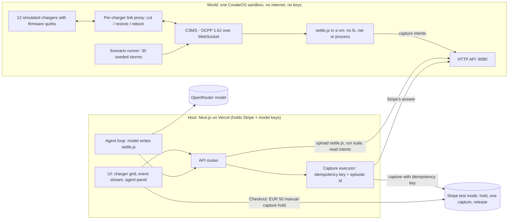

# Once

**Exactly-once payments for EV chargers.**

Once is an agent that writes the hold-meter-capture payment code for public EV chargers, runs that code inside a CreateOS sandbox that has no internet and no keys, and proves it against a fleet of simulated OCPP chargers that it can cut, reboot and reconnect at will. Stripe is the witness: the charger reports the stop twice, Stripe captures once (EUR 11.40), and the duplicate capture is refused by Stripe itself.

> Cut the cable, pull the plug, bring it back. The charger reported the stop twice. Stripe captured once: EUR 11.40.

Status: built during the CreateOS x Stripe "agent that writes and runs its own code" hackathon, from an empty directory, on a Stripe Projects stack. Everything money-related runs in **Stripe test mode** (see [Test-mode labelling](#test-mode-labelling)). Parts that are not live yet are marked **planned**.

| Piece | State |
|---|---|
| Stripe Projects stack (CreateOS, OpenRouter, Vercel) | provisioned, see `.projects/state.json` |
| `app/` Next.js host and UI | scaffold committed; UI and API routes **planned** (being built) |
| `world/` OCPP fleet, link proxy, scenario runner | **planned** (being built) |
| Docs: architecture, threat model, business, roadmap | written, in `docs/` |

---

## What this does, in plain words

A charge-point operator that takes card payments at an unattended charger has to do three things: hold money when the driver plugs in, meter the energy, and capture the right amount when the session ends. The hard part is that a charger is a device on a flaky link. OCPP 1.6 chargers queue their transaction messages while offline and resend them on reconnect, some firmware restarts an open transaction after a reboot (two sessions for one plug-in), and a Stop can arrive twice. Stripe allows exactly one capture per authorization, so payment code that captures on "first Stop it sees" either double-bills, strands the hold, or errors.

Once closes that loop:

1. The **agent** (a language model) writes the settlement program, `settle.js`: it reads the OCPP event stream and emits capture intents `{episode_id, payment_intent, amount_cents}`.
2. The program runs inside a **CreateOS sandbox** (the "world") that has an egress allowlist containing a single sinkhole, so it has no internet at all, and it holds no keys. Inside the same sandbox are a CSMS and 12 simulated chargers with documented firmware quirks, and a per-charger link proxy so any charger can be cut, restored or rebooted.
3. A **scenario suite** (30 seeded fault scenarios) runs in the sandbox and reports `stranded`, `double` and `unbilled` per scenario. If a scenario is red the agent rewrites `settle.js` and the suite runs again (up to 3 attempts).
4. Only **intents** leave the sandbox. The **host** executes each capture on Stripe with an idempotency key derived from the episode id and reports Stripe's answer back. Stripe is the final judge of "once".

## The 2-minute demo path

Once the app is live (planned: link added here when deployed). Cards are Stripe test cards.

1. **0:00** A grid of 12 chargers. Click charger 7 and pay a EUR 50 hold with `4242 4242 4242 4242` in Stripe Checkout. The tile reads "holding EUR 50"; in Stripe the PaymentIntent is *uncaptured*.
2. **0:20** **Cut cable** on charger 7's link: the tile goes grey and the charger keeps metering offline. **Unplug** while offline, then **Restore**. The queued StopTransaction arrives twice, about 1.2 s apart. The ledger accepts one, one capture of EUR 11.40 lands, EUR 38.60 is released. The receipt strip links the Stripe object.
3. **0:50** **The agent writes the fix.** Flip the "reboot restarts the transaction" quirk. The naive v1 settlement tries to capture twice and Stripe refuses the second capture (shown verbatim). Press **Fix**: the agent writes v2 (an episode ledger keyed to the plug-in episode, not the OCPP `transactionId`), the suite runs 30 storms in the sandbox and prints `stranded 0 | double 0 | unbilled 0`. v2 is deployed and the diff is shown.
4. **1:30** Why a sandbox: the world has no internet and no keys, the agent's code runs there, and only intents leave.
5. **1:50** The company: see [the company in five lines](#the-company-in-five-lines).

## Verify it yourself

**Today, with only a Stripe test key** (this is the money mechanic everything else rests on; no repo code needed):

```bash
# 1. A EUR 50 hold: manual capture, confirmed with a test card
PI=$(curl -s https://api.stripe.com/v1/payment_intents -u "$STRIPE_TEST_SECRET_KEY:" \
  -d amount=5000 -d currency=eur -d capture_method=manual \
  -d payment_method=pm_card_visa -d confirm=true \
  -d "payment_method_types[]=card" | jq -r .id)

# 2. Capture EUR 11.40 once. The remaining EUR 38.60 is released.
curl -s https://api.stripe.com/v1/payment_intents/$PI/capture -u "$STRIPE_TEST_SECRET_KEY:" \
  -d amount_to_capture=1140 | jq '{status, amount_received}'

# 3. Try to capture again. Stripe refuses.
curl -s https://api.stripe.com/v1/payment_intents/$PI/capture -u "$STRIPE_TEST_SECRET_KEY:" \
  -d amount_to_capture=1140 | jq .error.message
```

Use a key that starts with `sk_test_`. In our pre-build spike on a Stripe test sandbox this produced one capture of EUR 11.40 and a refusal of the second capture (Stripe's message says the remainder of the authorized amount has been released).

**With the world running locally** (planned, commands finalised when `world/` lands; see `world/README.md`):

```bash
cd world && npm install && node index.js      # CSMS + 12 chargers + HTTP API on :8080
# then run the 30-scenario suite against the v1 (naive) and v2 (episode ledger) settle.js
```

Expected: v1 shows non-zero `double` or `stranded` on the reboot-restart and duplicate-Stop scenarios; v2 shows `stranded 0 | double 0 | unbilled 0`. The results table below is filled from that run.

**On the deployed app** (planned): open the URL, run the demo path above, and open the Stripe Dashboard (test mode) to see exactly one captured PaymentIntent for the session.

## Provisioning: Stripe Projects from an empty directory

The whole stack was created from an empty directory with the Stripe Projects CLI (`stripe projects`, v0.50.0 at build time):

```bash
mkdir once && cd once
stripe projects init once
stripe projects add createos/free
stripe projects add createos/project
stripe projects add openrouter/free
stripe projects add openrouter/api
stripe projects add vercel/hobby
stripe projects add vercel/project
stripe projects env --pull          # writes the provider credentials into .env
```

The resulting resource list is committed in `.projects/state.json`. `.env` and `.projects/vault` are git-ignored. CreateOS provides the sandbox key (`CREATEOS_PROJECT_API_KEY`, aliased to `CREATEOS_SANDBOX_API_KEY` in code), OpenRouter the model, Vercel the host deployment.

## Architecture



Details in [docs/ARCHITECTURE.md](docs/ARCHITECTURE.md).

## Results

Filled from the world's suite when it exists. Until then only the design simulation is available.

| Check | Naive: capture on first Stop | Episode ledger | Episode ledger + MeterValues | Source |
|---|---|---|---|---|
| Double-capture attempts (10,000 random fault schedules) | 2,679 | 0 | 0 | model simulation, `ledger-sim.mjs` in the research scratchpad |
| Overbilled | 363 | 0 | 0 | same |
| Stranded holds | 332 | 332 | 0 | same |
| Under-billed (by at most one sampling interval) | n/a | n/a | 656 | same |

The simulation uses invented fault rates (30% reboot-split, 15% lost Start, 5% lost Stop, 50% duplicated Stop, arbitrary reorder). It is a model, not a measurement; it settles the design, it does not prove the product.

| World suite (30 seeded scenarios) | stranded | double | unbilled | State |
|---|---|---|---|---|
| v1 naive `settle.js` | pending | pending | pending | planned |
| v2 episode ledger `settle.js` (agent-written) | pending | pending | pending | planned |

## Threat model, summary

The code the agent writes is untrusted by construction, and it is the code that decides when money moves. So it never touches money.

- The world sandbox has **no egress** (allowlist is a single sinkhole) and **no keys**: nothing to exfiltrate to and nothing to exfiltrate.
- `settle.js` runs in a Node `vm` with no `fs`, `net` or `process`; its only output is capture intents.
- The **host** executes captures, with an idempotency key derived from the episode id, and bounds each intent by the hold.
- **Stripe refuses duplicates**: one capture per authorization, regardless of what the settlement program or the host does.

Full analysis, including what is not covered: [docs/THREAT_MODEL.md](docs/THREAT_MODEL.md).

## The company in five lines

1. **Who pays:** charge-point operators and CSMS vendors who must offer ad-hoc card payment at public points (EU AFIR, Regulation (EU) 2023/1804 Art. 5).
2. **Market:** 1.1 million public charge points in the EU at the end of 2025, five times 2020 (Transport & Environment, July 2026).
3. **Price (estimate):** EUR 2-5 per charger per month for the proven payment module and fault suite; EUR 0.5-1k per month per CSMS vendor for the conformance runner.
4. **Moat:** a library of real firmware deviations as runnable scenarios, growing with every customer run.
5. **Next rung:** a conformance venue where charger makers and CSMS vendors certify "pays exactly once while offline".

See [docs/BUSINESS.md](docs/BUSINESS.md) and [docs/ROADMAP.md](docs/ROADMAP.md).

## Built during the event

Once was built from an empty directory during the CreateOS x Stripe hackathon. The research that chose the idea (market sources, OCPP behaviour, the Scoop-Check) predates the build and is cited in the docs; the product code in this repository (`app/`, `world/`) and these documents were written during the event. Commits in `git log` are the record.

## Test-mode labelling

All payments in this project are Stripe **test mode**: the Checkout page, the holds, the captures and the "refused duplicate" are test objects, paid with test cards, and no real money moves. The EUR figures in the demo are illustrative amounts on test objects. Pricing and market figures in the docs are labelled as estimates or sourced. The Stripe account used for payments is a test sandbox; the Stripe Projects account provides the stack.

## Repository layout

```
README.md          this file
docs/              ARCHITECTURE, THREAT_MODEL, BUSINESS, ROADMAP
app/               Next.js host: UI, API routes, agent loop, Stripe executor (in progress)
world/             OCPP fleet, link proxy, settle.js loader, scenario runner (planned)
.projects/         Stripe Projects state (resources provisioned for this stack)
```
