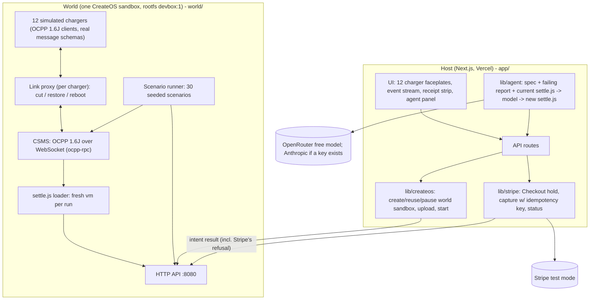

# Architecture

Status key: **live** = exists in this repository and was checked; **planned** = specified, being built, not yet verified. At the time of writing the Stripe Projects stack is provisioned and the Next.js app is a scaffold; `world/` and the app's routes are planned. This document describes the design the other streams are building to, and is updated as their READMEs land.

## 1. The one idea

Money must move **once per plug-in episode**, not once per message. Chargers on a flaky link queue and resend transaction messages, some firmware restarts an open transaction after a reboot, and a Stop can arrive twice. Stripe permits exactly one capture per authorization. So the payment code must bind a capture to the *episode* (charger, connector, Checkout Session), never to the OCPP `transactionId`, and it must be proven under partitions, not just read.

Once separates three roles so that code written by a model can be tested hard without being trusted with money:

| Role | Where | Holds keys? | Can reach the internet? |
|---|---|---|---|
| **Decide**: the settlement program `settle.js` turns OCPP events into capture intents | inside the world sandbox, in a `vm` | no | no |
| **Execute**: perform the capture on Stripe | the host | yes (Stripe, model) | yes |
| **Witness**: refuse anything that is not exactly once | Stripe | n/a | n/a |

## 2. Components

### 2.1 The world (`world/`, planned)

One Node process in one CreateOS sandbox (rootfs `devbox:1`). The sandbox's egress allowlist contains a single sinkhole entry, so the process has no route to the internet; in our access spike the allowlist blocked Stripe, example.com and 1.1.1.1. It runs:

- **CSMS**: an OCPP 1.6J central system over WebSocket using the `ocpp-rpc` library.
- **12 simulated chargers**: OCPP 1.6J clients using real message schemas, with documented firmware quirks (section 4).
- **Link proxy**: each charger connects to the CSMS through its own proxy, so the harness can cut a link, restore it, or reboot the charger independently. This is how "cut the cable" is implemented in the single-sandbox design.
- **Settlement program** `settle.js`: written by the agent, loaded fresh for every run in a `vm`. It consumes the OCPP event stream and emits capture intents `{episode_id, payment_intent, amount_cents}`. It never touches Stripe.
- **Scenario runner**: 30 seeded, deterministic fault scenarios. Each reports `stranded`, `double`, `unbilled`.
- **HTTP API on port 8080**: state snapshot, commands (cut, restore, reboot, plug, unplug, quirk toggles), pending intents, intent results, scenario runs, `settle.js` upload. The host reaches it through the sandbox's `previewUrl(8080)` (plain http).

The same code runs locally with `node world/index.js` for development; the host has a local mode that talks to `localhost` instead of the sandbox.

### 2.2 The host (`app/`, scaffold live, routes planned)

A Next.js app deployed on Vercel (provisioned through Stripe Projects). It:

- creates or reuses the world sandbox with the CreateOS SDK (`CREATEOS_PROJECT_API_KEY`, aliased to `CREATEOS_SANDBOX_API_KEY`), uploads `world/`, starts it, and keeps it paused when idle (the free plan allows 1 concurrent sandbox and 10 creates per rolling 24 hours);
- creates Stripe Checkout Sessions (EUR, `payment_intent_data.capture_method=manual`, EUR 50 hold) for "plug in charger N";
- polls the world for pending capture intents, **executes each capture on Stripe with an idempotency key derived from the world's intent id (with the hold and episode)**, and posts Stripe's answer back to the world so a refused duplicate is visible with Stripe's own words;
- runs the agent loop (section 3).

### 2.3 The stack (Stripe Projects)

Provisioned from an empty directory: `createos/free`, `createos/project`, `openrouter/free`, `openrouter/api`, `vercel/hobby`, `vercel/project` (see `.projects/state.json`, **live**). Payments use a Stripe test sandbox's keys held in `.env`; they exist only on the host.

## 3. The agent loop

1. Inputs: the written spec of settlement behaviour, the current `settle.js`, and the latest scenario report (which scenarios are red and why).
2. The model writes a new `settle.js` (model: an OpenRouter free model via Stripe Projects; Anthropic if `ANTHROPIC_API_KEY` is present).
3. The host uploads it to the world; the world loads it into a fresh `vm`.
4. The 30-scenario suite runs inside the sandbox. Results stream to the UI.
5. Repeat until `stranded 0 | double 0 | unbilled 0` or 3 attempts. The diff against the previous version is shown.

The model writes code and fixes; **it never decides a capture at runtime**. Once written, `settle.js` is deterministic. The oracle is code: captured amounts reconciled per episode against the chargers' meter readings, and stranded holds counted from uncaptured intents past their timeout.

Honesty note for the demo: the v1 to v2 fix path is staged (the failing scenario is pre-set and the fix path rehearsed); the live model produces v2 on screen, but the demo does not claim the model discovers the episode-ledger idea cold.

## 4. The episode ledger (what v2 must implement)

From the research dossier (D4):

- Episode = a plug-in, keyed by (charger, connector, Checkout Session), not by OCPP `transactionId`. A reboot-split session yields two transactions in one episode.
- Deduplicate Stop messages by hash(charger, transaction, meterStop), plus a PAYGo-style accepted window on meter monotonicity (OCPP 2.0.1's `seqNo` for gap detection if that profile is added).
- Capture is bound to the connector returning to Available (or hold timeout minus a margin).
- One idempotency key per capture intent; a partial capture releases the remainder.
- MeterValues keep a lower bound so a lost Stop still bills something.

Firmware quirks the simulator reproduces (each documented in vendor KBs or the OASIS OCPP list, see the dossier): queue transactions offline and resend on reconnect; deliver a queued StopTransaction twice; reboot splits one plug-in into two transactions; Stop for a never-seen Start; meter reset on reboot.

In the design simulation (10,000 randomized fault schedules, invented fault rates, a model and not a measurement), naive "capture on first Stop" produced 2,679 double-capture attempts, 363 overbilled and 332 stranded holds; the episode ledger produced 0 double, 0 overbilled, 332 stranded; the episode ledger with MeterValues produced 0 double, 0 overbilled, 0 stranded, with 656 under-billed by at most one sampling interval.

## 5. Data flow of the golden path

1. Driver pays the EUR 50 hold in Checkout; the host records the PaymentIntent id against the charger's episode and tells the world the episode has a hold.
2. Charger 7 starts a transaction; the link is cut; the charger keeps metering and queues messages.
3. On restore, the queued StopTransaction arrives twice. `settle.js` accepts one and drops the duplicate; it emits one intent `{episode_id, payment_intent, amount_cents: 1140}`.
4. The host captures `amount_to_capture=1140` with an idempotency key derived from the intent id. The remaining EUR 38.60 is released by Stripe.
5. With the naive v1 and the reboot-restart quirk, two intents are emitted; the second capture is refused by Stripe and that refusal is shown, then v2 is written and the suite re-run.

## 6. Failure and degraded modes

- **The cut does not sever an established WebSocket.** Because chargers connect through the world's own link proxy, "cut" is implemented by the proxy dropping the connection and refusing reconnects, not by relying on a network-level detach. Every cut is shown in the event stream. (A multi-sandbox design using CreateOS network detach/attach was considered in the dossier; the build uses one sandbox because of free-plan limits.)
- **Sandbox quota.** The world is reused and paused when idle; a local mode (`world/` on localhost) is the fallback and is labelled as local in the UI.
- **Model unavailable or slow.** The host has a timeout; the demo falls back to the last good `settle.js` and says so.
- **Stripe unreachable.** Intents stay pending in the world; nothing is lost and nothing is captured twice, because each intent's idempotency key is fixed.

## 7. What is not in the design

No real chargers, no real firmware, no OCPP 2.0.1 in the first build, no incremental authorization demo in the first build (planned, see the roadmap), no production database (episode state lives in the world and the Stripe objects; Stripe is the system of record for money).
